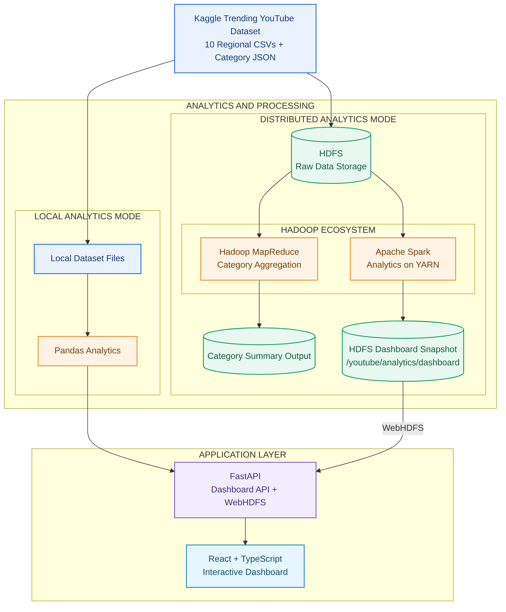
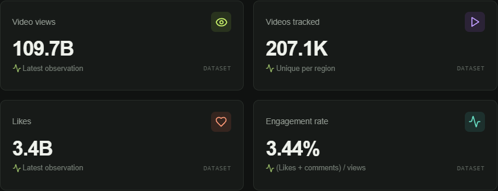
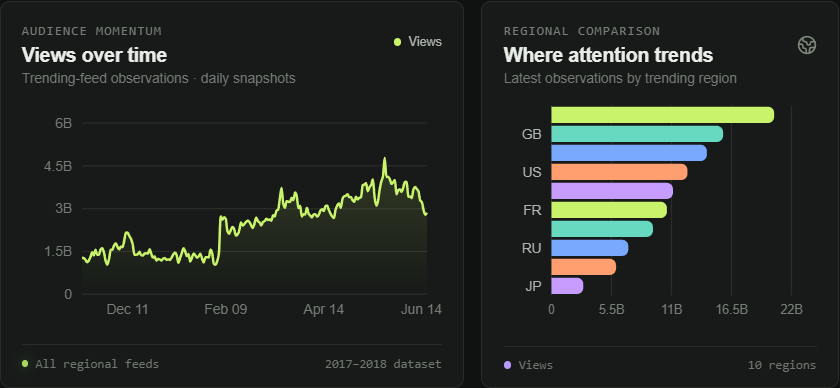
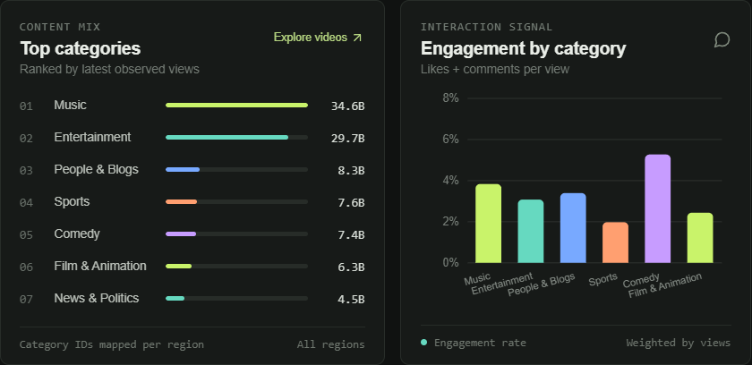
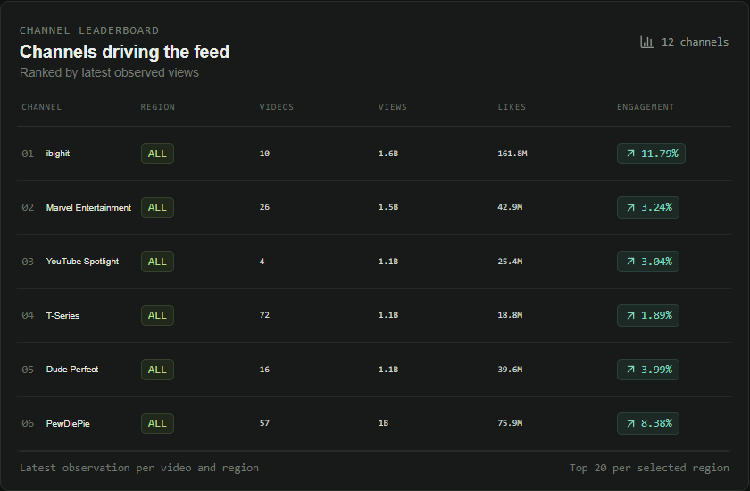
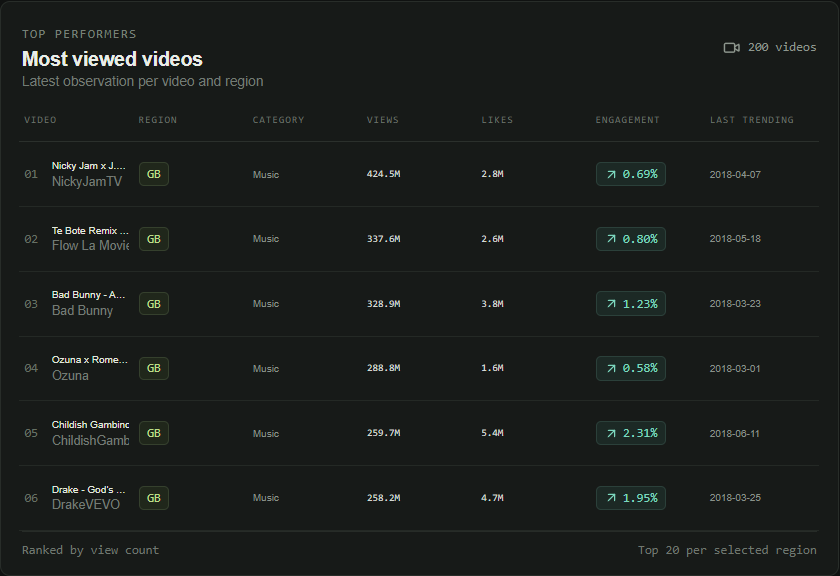

<h1 align="center">YouTube Video Analytics Platform</h1>

<p align="center">
  A distributed Big Data analytics platform for exploring
  historical YouTube trending video statistics.
</p>

<p align="center">
  
  
  
  
  
</p>


## Project report

- **Project type:** Distributed data processing and interactive analytics dashboard
- **Data source:** Kaggle Trending YouTube Video Statistics
- **Processing technologies:** Hadoop HDFS, Hadoop MapReduce, Apache Spark/PySpark on YARN, and Pandas local mode
- **Application technologies:** Python FastAPI, React, TypeScript, and Vite

## Abstract

This project analyzes historical YouTube trending-video observations from ten regional feeds. A Java Hadoop MapReduce job aggregates observations by region and category ID. A PySpark job is designed to process the source CSVs on YARN, enrich them with regional category labels, calculate latest-observation metrics and trends, and write a compact dashboard snapshot to HDFS. FastAPI serves either that persisted snapshot through WebHDFS or a cached Pandas analysis of the local dataset. A shared React dashboard visualizes the same dashboard data contract in either mode.

The local analytics path has been run against the downloaded Kaggle files. It produced 375,942 valid observations and the measured outputs in the Results section below. The repository also contains the MapReduce and PySpark implementations and cluster workflow.

## 1. Introduction

Video engagement data is naturally multi-dimensional: it can be grouped by date, region, video, category, and channel. Repeated observations of the same video also require care: view counts are cumulative counters in snapshots, so summing every row as if it represented new views would inflate totals.

This project provides an end-to-end example of storing and processing this dataset with Hadoop technologies, serving dashboard-ready analytics through a web API, and exploring results through an interactive dashboard. Local Analytics mode provides a way to run the same dashboard using Pandas when a user is developing or demonstrating the interface without submitting a cluster job.


## Table of Contents

- [Project Overview](#what-the-platform-analyzes)
- [Metric Logic](#metric-logic)
- [Architecture and Data Flow](#architecture-and-data-flow)
- [Repository Structure](#repository-layout)
- [Run the Application](#run-the-application-on-windows)
- [Required Applications](#required-applications-and-where-they-go)
- [Three-PC Cluster Setup](#three-pc-cluster-topology)
- [Process the Dataset](#process-the-dataset-on-the-cluster)
- [API Reference](#api-and-dashboard-endpoints)
- [Compatibility Notes](#compatibility-and-interpretation-notes)
- [Development Checks](#development-checks)


### Problem statement

Build a reproducible analytics platform that processes regional trending-video data, calculates interpretable engagement and ranking metrics, and makes those results accessible through a web dashboard. The distributed workflow must use HDFS for storage, YARN for job scheduling, an actual Hadoop MapReduce job, and PySpark for dashboard analytics.

### Aim and objectives

- Store the regional source files in HDFS for distributed processing.
- Use a Java MapReduce job to summarize observations by region and category ID.
- Use PySpark on YARN to build a dashboard snapshot from the original CSV and category JSON files.
- Expose dashboard data through a FastAPI API and WebHDFS snapshot reader.
- Provide a React dashboard with region filtering, trends, comparisons, and ranked tables.
- Provide a cached Pandas mode with a compatible dashboard schema for local use.
- Avoid fabricated results and distinguish snapshot counters from increments or viewer demographics.

## 2. Dataset and scope

The project uses the [Trending YouTube Video Statistics dataset on Kaggle](https://www.kaggle.com/datasets/datasnaek/youtube-new). It contains a CSV and category metadata JSON for each of ten regions: US, CA, GB, DE, FR, IN, JP, KR, MX, and RU. The archive is from 2017–2018 and contains daily observations of videos appearing in regional trending feeds.

The downloaded archive is located at `data/youtube-new.zip`, with extracted files in `data/youtube-new/`. The archive contains 375,942 CSV observations, and `data/` is excluded from Git. The CSVs are research input, not a live YouTube API feed.

**Interpretation constraints**

- A region identifies the trending feed where an observation appeared; it does not identify a viewer's location.
- The dataset covers trending videos, not every video on YouTube.
- Views, likes, and comments are counters recorded in historical snapshots. They are not daily increments or unique viewers.
- The data is historical and should not be described as current YouTube performance.

## 3. System architecture



### Components

| Component | Responsibility |
|---|---|
| HDFS | Distributed storage for raw regional files and processing outputs. |
| YARN | Resource management and scheduling for Hadoop MapReduce and Spark applications. |
| Hadoop MapReduce | Reads regional CSV observations and aggregates observation count, views, likes, and comments by region and category ID. |
| PySpark | Parses and cleans source rows, enriches categories, selects latest observations, calculates metrics and rankings, and writes dashboard JSON. |
| FastAPI | Exposes health and dashboard endpoints; selects local Pandas analytics or persisted HDFS snapshot access via configuration. |
| WebHDFS reader | Lists and reads Spark `part-*` output from the configured HDFS dashboard directory. |
| Pandas local analytics | Reads all ten regional CSVs and category JSONs and caches the computed dashboard payload in memory. |
| React dashboard | Presents overview metrics, regional comparison, trends, category analytics, channel and video leaderboards, and the active data mode. |

### Repository structure

```text
analytics/jobs/build_dashboard.py        PySpark dashboard analytics job
backend/app/config.py                    Environment-based API configuration
backend/app/local_analytics.py           Pandas analytics and in-memory cache
backend/app/main.py                      FastAPI routes and mode selection
backend/app/snapshot.py                  WebHDFS/local persisted snapshot reader
backend/tests/                           API, analytics, cache, and snapshot tests
frontend/src/                             React dashboard and styles
hadoop/mapreduce/                        Java MapReduce job and Maven build
scripts/ingest_kaggle.sh                 Validate and copy source files to HDFS
scripts/verify_cluster.sh                Inspect DataNodes and YARN nodes
data/                                    Downloaded dataset; Git-ignored
```

## 4. Data processing methodology

### Cleaning and enrichment

The Pandas and PySpark pipelines read the same ten regional CSVs and regional category metadata. They convert numeric metrics to integers, coerce malformed/missing counts to zero, parse trending dates, and discard records with an empty video ID or an invalid trending date. Category names are joined using both region and category ID because regional category mappings can differ. An unmapped category falls back to its ID.

### Latest-observation and trend metrics

For overview totals, regional/category/channel aggregates, and ranked videos, the pipeline selects the latest valid record for each `(region, video_id)`. This prevents cumulative counters from being repeatedly added across dates. Trend series instead aggregate all valid dated observations for each `(region, trending_date)`.

Engagement rate is calculated from aggregated counts:

```text
engagement_rate (%) = 100 × (likes + comments) / views
```

The rate is zero if views are zero and is rounded to four decimal places in the analytics payload. The dashboard's overall rate is weighted by total views because it is calculated from summed likes, comments, and views.

### Distributed job outputs

- **MapReduce output:** one tab-separated record per `(region, category_id)`, containing observation count, summed views, summed likes, and summed comments. The job includes a custom CSV input reader for quoted/multiline rows and uses a combiner before the reducer.
- **PySpark output:** one JSON dashboard payload written as a Spark text output under `/youtube/analytics/dashboard`. Spark performs aggregation before collecting the compact dashboard result; it does not collect the raw dataset to the driver. Output publication uses a temporary HDFS directory and preserves the prior result during replacement.
- **Local output:** Pandas returns the same top-level dashboard sections and fields as the Spark payload, caches the result in memory, and refreshes it after the configured cache duration.

### Dashboard data contract

Both analytics modes return the same dashboard sections:

```text
metadata, overview, countries, categories, channels, videos, trends
```

FastAPI endpoints:

| Method and path | Description |
|---|---|
| `GET /api/health` | API liveness and selected analytics mode. |
| `GET /api/dashboard` | Full dashboard payload. |
| `GET /api/dashboard?region=US` | Dashboard data filtered to a supported region. |
| `GET /docs` | FastAPI interactive API documentation. |

## 5. Dashboard features

- Summary cards for views, videos tracked, likes, and engagement rate.
- Region filter for all ten regional feeds.
- Dated view trends and regional comparisons.
- Category totals and engagement comparisons.
- Channel and video leaderboards.
- An **About the data** dialog describing the source and metric interpretation.
- Visible Local Analytics/HDFS snapshot mode identification.
- Loading, missing-data, and API error states instead of fabricated placeholder statistics.

The same React interface works with both API modes; analytics presentation is not duplicated between them.

### Screenshots

The following screenshots were captured from the running dashboard using the downloaded dataset.

**Summary metrics**



**Views over time and regional comparison**



**Top categories and engagement by category**



**Channel leaderboard**



**Top video performers**



## 6. Results from the real dataset

The following figures were produced by running the Pandas pipeline on `data/youtube-new/` in this project workspace. They are dataset-derived results, not hardcoded dashboard values.

| Result | Measured value |
|---|---:|
| Valid source observations | 375,942 |
| Latest `(region, video_id)` records | 207,148 |
| Regional feeds | 10 |
| Region/category aggregates | 167 |
| Channel leaderboard rows | 220 |
| Ranked video rows | 200 |
| Region/date trend rows | 1,967 |
| Latest-observation views total | 109,748,063,568 |
| Latest-observation likes total | 3,360,407,704 |
| Latest-observation comments total | 418,671,184 |
| Overall engagement rate | 3.4434% |
| Trend date range | 2017-11-14 to 2018-06-14 |

The 220 channel rows comprise the global top 20 and up to 20 per each of the ten regions. The 200 video rows comprise up to 20 videos per region. These are bounded dashboard rankings, not a count of all channels or videos in the source.

## 7. Verification and evidence

Backend tests cover the local payload schema, metric calculations, latest-observation behavior, cache behavior, API mode selection, region filtering, missing data, and WebHDFS snapshot reading. The local payload schema is checked against the Spark job's dashboard schema. The frontend production build runs TypeScript project checks and Vite bundling.

| Verification | Evidence |
|---|---|
| Local analytics on the downloaded source data | Executed successfully; output counts and totals are listed in Results. |
| Backend automated tests | 18 tests passed in the last recorded full run. |
| Frontend production build | Passed after dashboard UI changes. |
| MapReduce and PySpark implementations | Source and submission workflows are included in this repository. |
| Three-node YARN execution | Must be evidenced by cluster node status, YARN application details/logs, and worker task placement; local tests/builds do not establish this. |

For an academic distributed-processing demonstration, retain command output or screenshots showing `hdfs dfsadmin -report`, `yarn node -list`, successful MapReduce output, and a successful YARN Spark application with tasks on both workers. Screenshots of the UI alone demonstrate the frontend, not distributed execution.

## 8. Running the local application on Windows

The current local workflow runs FastAPI and React on Windows and uses the downloaded dataset. The Hadoop cluster daemons are configured to run in Linux environments.

### Prerequisites

- Python 3.12 for the FastAPI environment (the backend requirements support Python 3).
- Node.js 22 LTS and npm.
- The extracted dataset under `data/youtube-new/`.

### Start FastAPI

From PowerShell at the project root:

```powershell
python -m venv backend\.venv
.\backend\.venv\Scripts\python.exe -m pip install -r backend\requirements-dev.txt
Set-Location backend
$env:ANALYTICS_MODE = "local"
$env:ANALYTICS_DATASET_DIR = "D:\YoutubeInsights\data\youtube-new"
.\.venv\Scripts\python.exe -m uvicorn app.main:app --reload
```

The first dashboard request reads the ten CSVs and ten category JSONs. Results are cached in memory for 300 seconds by default; override this with `LOCAL_ANALYTICS_CACHE_SECONDS`.

### Start the React dashboard

In a second PowerShell terminal:

```powershell
Set-Location D:\YoutubeInsights\frontend
npm ci
npm run dev
```

Open the localhost address printed by Vite (normally `http://localhost:5173`). FastAPI runs at `http://localhost:8000`; its API docs are at `http://localhost:8000/docs`.

## 9. Three-PC distributed deployment workflow

### Topology

All three physical laptops may retain Windows as the host OS, while running Hadoop daemons in Linux environments that can communicate over the trusted LAN. Bridged-network Linux VMs are one option. WSL2 networking can require additional configuration; three virtual machines on one laptop do not satisfy the three-PC topology.

| Node | Services | Role |
|---|---|---|
| `master` | NameNode, ResourceManager, JobHistoryServer | HDFS namespace, job submission and resource scheduling. |
| `worker1` | DataNode, NodeManager | HDFS block storage and YARN task execution. |
| `worker2` | DataNode, NodeManager | HDFS block storage and YARN task execution. |

With two DataNodes, use HDFS replication factor 2. The single NameNode and ResourceManager are single points of failure in this minimum academic topology.

### Software baseline

Use mutually compatible versions and the same Hadoop configuration across nodes. The project setup baseline is:

| Software | Placement |
|---|---|
| Ubuntu 22.04 LTS or another supported Linux distribution | Linux runtime on each separate cluster laptop. |
| Apache Hadoop 3.3.6 and supported OpenJDK 11 | All three cluster nodes. |
| Apache Spark 3.5.3 built for Hadoop 3 | Master submission host; make Spark runtime/JARs available to YARN executors. |
| Python 3.10 | Spark submission host and workers, at a consistent interpreter path. |
| Maven 3.9.x | Master/build host for the Java job. |
| OpenSSH | Cluster Linux hosts for Hadoop daemon management. |
| Node.js 22 and Python 3.12 | UI and FastAPI development/hosting machine as needed. |

Official downloads: [Ubuntu Server](https://ubuntu.com/download/server), [Hadoop 3.3.6](https://archive.apache.org/dist/hadoop/common/hadoop-3.3.6/), [Spark 3.5.3](https://archive.apache.org/dist/spark/spark-3.5.3/), [Maven](https://maven.apache.org/download.cgi), and [Node.js](https://nodejs.org/). Docker is not required.

### Configure and start the cluster

Configure `core-site.xml`, `hdfs-site.xml`, `mapred-site.xml`, and `yarn-site.xml` consistently on all nodes:

- Set `fs.defaultFS` to the NameNode RPC address.
- Set `dfs.replication=2` and unique NameNode/DataNode storage directories.
- Set `mapreduce.framework.name=yarn`.
- Set the ResourceManager hostname and the MapReduce shuffle service for the Hadoop version.
- List `worker1` and `worker2` in the Hadoop `workers` file.

Configure `JAVA_HOME`, `HADOOP_HOME`, `HADOOP_CONF_DIR`, SSH, hostname resolution, time synchronization, and trusted-LAN firewall rules. WebHDFS clients must be able to reach both the NameNode and the DataNode address returned by the NameNode redirect.

Format only a new, empty NameNode storage directory. Formatting an initialized NameNode can destroy HDFS namespace metadata. Start HDFS and YARN with the distribution scripts, then verify the cluster:

```bash
hdfs dfsadmin -report
yarn node -list
```

Common web interfaces are NameNode `http://master:9870` and ResourceManager `http://master:8088`; verify the ports in the actual configuration.

### Ingest and process the dataset

Copy the extracted dataset to the master, then, from the project root in the Linux environment:

```bash
chmod +x scripts/*.sh
HDFS_RAW_DIR=/youtube/raw scripts/ingest_kaggle.sh /path/to/youtube-new
hdfs dfs -ls /youtube/raw
```

Build and run the actual Hadoop MapReduce job:

```bash
cd hadoop/mapreduce
mvn -DskipTests package
cd ../..
hadoop jar hadoop/mapreduce/target/youtube-mapreduce-1.0.0.jar \
  mr.YouTubeCategorySummary \
  hdfs:///youtube/raw \
  hdfs:///youtube/analytics/mapreduce-category-summary
hdfs dfs -cat /youtube/analytics/mapreduce-category-summary/part-*
```

Run the PySpark dashboard analytics on YARN:

```bash
spark-submit \
  --master yarn \
  --deploy-mode client \
  analytics/jobs/build_dashboard.py \
  --input 'hdfs:///youtube/raw/*videos.csv' \
  --categories 'hdfs:///youtube/raw/*_category_id.json' \
  --output hdfs:///youtube/analytics/dashboard
hdfs dfs -ls /youtube/analytics/dashboard
yarn application -list
```

Inspect YARN application logs and confirm executors/tasks ran on both worker machines. Spark local mode is not evidence of multi-node processing. Use a dedicated output path under `/youtube/analytics/`; do not direct the Spark job at raw input.

### Connect FastAPI to the HDFS snapshot

Run FastAPI on the master or another host with WebHDFS connectivity:

```bash
cd backend
python3 -m venv .venv
source .venv/bin/activate
pip install -r requirements.txt
export ANALYTICS_MODE=hdfs
export HDFS_WEBHDFS_URL=http://master:9870/webhdfs/v1
export HDFS_USER=hadoop
export HDFS_DASHBOARD_PATH=/youtube/analytics/dashboard
uvicorn app.main:app --host 0.0.0.0 --port 8000
```

If FastAPI runs on Windows, set the same values in PowerShell (for example `$env:ANALYTICS_MODE = "hdfs"`). Replace `master` with a reachable host name or address. `ANALYTICS_SNAPSHOT_FILE` can be used to read an actual copied Spark `part-*` JSON file instead of WebHDFS.

Start the React development server with:

```bash
cd frontend
npm ci
npm run dev -- --host 0.0.0.0
```

The development proxy defaults to `http://localhost:8000`; configure `VITE_API_PROXY_TARGET` when the API is elsewhere. For production, build the frontend with `VITE_API_BASE_URL` set to the API URL and set FastAPI `CORS_ORIGINS` to the frontend origin.

## 10. Configuration reference

| Variable | Purpose | Default |
|---|---|---|
| `ANALYTICS_MODE` | Select `local` Pandas or `hdfs` snapshot mode. | `local` |
| `ANALYTICS_DATASET_DIR` | Local directory containing regional CSVs and category JSONs. | Project `data/youtube-new/`. |
| `LOCAL_ANALYTICS_CACHE_SECONDS` | Local results cache duration. | `300` seconds. |
| `HDFS_WEBHDFS_URL` | WebHDFS base URL including `/webhdfs/v1`. | `http://localhost:9870/webhdfs/v1` |
| `HDFS_USER` | WebHDFS simple-auth user. | `hadoop` |
| `HDFS_DASHBOARD_PATH` | HDFS directory containing Spark output. | `/youtube/analytics/dashboard` |
| `ANALYTICS_SNAPSHOT_FILE` | Optional local path to a real Spark output JSON file. | Unset. |
| `SNAPSHOT_CACHE_SECONDS` | Cache duration for persisted HDFS/local snapshot reads. | `15` seconds. |
| `CORS_ORIGINS` | Comma-separated frontend origins allowed by FastAPI. | Local Vite origins. |
| `VITE_API_BASE_URL` | API base URL embedded in the production frontend build. | Same-origin/empty. |
| `VITE_API_PROXY_TARGET` | FastAPI URL used by the Vite development proxy. | `http://localhost:8000` |

## 11. Testing and development commands

From the project root in Windows PowerShell:

```powershell
.\backend\.venv\Scripts\python.exe -m pytest
python -m compileall -q analytics\jobs backend\app
Set-Location frontend
npm ci
npm run build
```

The tests verify local metric calculations and latest-observation behavior, output schema, caching, missing-data handling, API region filtering/mode selection, and snapshot reading. The production build performs TypeScript checks and bundles the React app.

## 12. Future work

- Add deployment automation and service health/monitoring for the three nodes.
- Add secured Hadoop access and HTTPS reverse-proxy deployment guidance.
- Add scheduled ingestion and repeatable analytics runs with dated/versioned snapshots.
- Add explicit data-quality and run metadata to API responses.
- Add integration tests against a provisioned HDFS/YARN cluster and compare full local/Spark aggregate results.
- Add dashboard export and richer date/category/channel filtering.

## 13. References

1. [Kaggle: Trending YouTube Video Statistics](https://www.kaggle.com/datasets/datasnaek/youtube-new) — dataset and source files.
2. [Reference repository: youtubeDataAnalysis](https://github.com/ishmeetkohli/youtubeDataAnalysis) — initial project reference.
3. [Apache Hadoop](https://hadoop.apache.org/) — HDFS, YARN, and MapReduce framework.
4. [Apache Spark](https://spark.apache.org/) — distributed analytics framework.
5. [FastAPI](https://fastapi.tiangolo.com/) — Python API framework.
6. [React](https://react.dev/) and [Vite](https://vite.dev/) — frontend library and build tooling.
